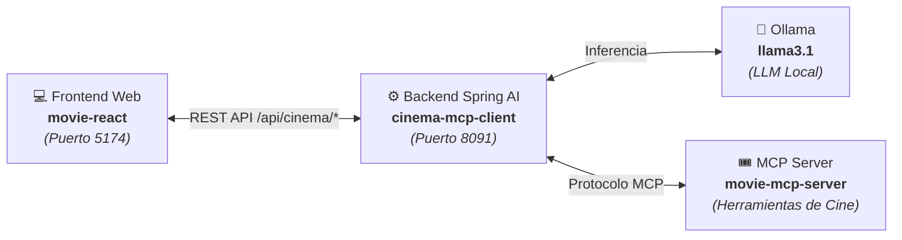

# 🎬 Cinema AX — Movie React Frontend

> **Interfaz web moderna, reactiva y conversacional para el Asistente de Cine con Spring AI y Model Context Protocol (MCP).**

[](https://react.dev/)
[](https://www.typescriptlang.org/)
[](https://vitejs.dev/)
[](https://tailwindcss.com/)
[](https://zustand.docs.pmnd.rs/)

---

## 📖 Contexto del Proyecto

**Cinema AX (`movie-react`)** es la aplicación cliente frontend diseñada para interactuar de forma intuitiva y natural con el ecosistema de inteligencia artificial para cines basado en **Spring AI** y **Model Context Protocol (MCP)**.

### 🌐 El Ecosistema Completo

Este proyecto forma parte de una arquitectura modular de tres capas:



1. **[movie-react](https://github.com/jhonduarte7/movie-react)** *(este repositorio)*: Interfaz web de usuario construida con React 19, TypeScript, Tailwind CSS v4 y Zustand.
2. **[cinema-mcp-client](https://github.com/jhonduarte7/cinema-mcp-client)**: Backend orquestador en Spring Boot 3.x y Spring AI que gestiona la conversación con Ollama (`llama3.1`) y consume las herramientas del servidor MCP.
3. **[movie-mcp-server](https://github.com/jhonduarte7/movie-mcp-server)**: Servidor MCP independiente que expone herramientas de consulta a base de datos de películas (catálogo, salas, horarios, clasificaciones y directores).

---

## ✨ Características Principales

- 🤖 **Asistente Conversacional Inteligente**: Envía preguntas en lenguaje natural para consultar horarios, películas en cartelera, sinopsis y recomendaciones.
- 🎯 **Filtros de Preferencias**: Posibilidad de filtrar o sesgar las consultas por género (*Sci-Fi, Acción, Animación, Drama, Comedia, Terror*) o por edad de audiencia (*Familiar, PG-13, Adultos*).
- ⚡ **Consultas Rápidas en 1 Clic**: Tarjetas de acceso directo para consultar horarios de hoy, películas más valoradas, recomendaciones de ciencia ficción y contenido familiar.
- 📊 **Respuestas Enriquecidas (Markdown & Tablas)**: Renderizado dinámico de tablas de horarios, salas de proyección (IMAX, Dolby Atmos), listas y formatos de cine.
- 🌙 **Tema Claro / Oscuro**: Selector de apariencia (Dark, Light o Sincronización con el Sistema) con transiciones suaves y persistencia en `localStorage`.
- 🔌 **Indicador de Conexión en Tiempo Real**: Badge dinámico que monitoriza el estado del backend Spring Boot (`http://localhost:8091`) y el modelo activo (`llama3.1`).
- 🛡️ **Modo Standby / Simulación Offline**: Si el backend de Spring Boot aún no está iniciado, la interfaz no se rompe; activa un modo de previsualización con datos simulados realistas para pruebas rápidas de UI.

---

## 🛠️ Stack Tecnológico

- **Frontend Core**: [React 19](https://react.dev/) + [TypeScript](https://www.typescriptlang.org/)
- **Empaquetador y Dev Server**: [Vite 6](https://vitejs.dev/) con proxy inverso automático para `/api`
- **Estilos**: [Tailwind CSS v4](https://tailwindcss.com/)
- **Gestión de Estado**: [Zustand 5](https://zustand.docs.pmnd.rs/)
- **Cliente HTTP**: [Axios](https://axios-http.com/) con control de timeouts y resiliencia
- **Renderizado Markdown**: `react-markdown` + `remark-gfm`
- **Iconos**: [Lucide React](https://lucide.dev/)

---

## 🚀 Guía de Instalación y Ejecución

### 1. Requisitos Previos

- **Node.js**: Versión 18.0.0 o superior instalada.
- **npm**: Versión 9 o superior (incluido con Node.js).
- *(Opcional)*: Backend **`cinema-mcp-client`** corriendo en el puerto `8091` para respuestas reales de IA.

### 2. Clonar el Repositorio

```bash
git clone https://github.com/jhonduarte7/movie-react.git
cd movie-react
```

### 3. Instalar Dependencias

```bash
npm install
```

### 4. Configurar Variables de Entorno

Copia el archivo de ejemplo o ajusta `.env`:

```bash
cp .env.example .env
```

Contenido de `.env`:

```env
# URL base del Backend Spring Boot Cinema MCP Client (puerto 8091)
VITE_API_TARGET=http://localhost:8091
VITE_APP_TITLE=Cinema AX - Cinema MCP Client
```

### 5. Iniciar Servidor de Desarrollo

```bash
npm run dev
```

La aplicación se abrirá en tu navegador en:
👉 **`http://localhost:5174/`**

> **Nota sobre el puerto**: Se utiliza el puerto `5174` por defecto para evitar colisiones con otros servidores frontend locales en el `5173`.

### 6. Compilar para Producción

```bash
# Comprobación de tipos TypeScript y empaquetado optimizado
npm run build

# Previsualizar la compilación de producción localmente
npm run preview
```

---

## 📡 Integración de Endpoints (Spring AI)

El frontend se comunica con los siguientes endpoints del backend Spring Boot:

| Endpoint | Método | Descripción |
| :--- | :--- | :--- |
| `/api/cinema/ask` | `POST` | Envía la pregunta en lenguaje natural y la preferencia del usuario opcional. |
| `/api/cinema/recommend` | `GET` | Consulta recomendaciones filtradas por parámetro `genre`. |
| `/api/cinema/status` | `GET` | Health check del backend y validación de conexión con herramientas MCP. |

---

## 📁 Estructura del Código Fuente

```
src/
├── components/
│   ├── chat/
│   │   ├── ChatFeed.tsx        # Contenedor de mensajes y scroll automático
│   │   ├── ChatInput.tsx       # Barra de entrada de texto, selector de género y atajos
│   │   ├── ChatMessage.tsx     # Tarjeta de mensaje con soporte Markdown y tablas
│   │   └── QuickPrompts.tsx    # Tarjetas de sugerencias rápidas
│   └── common/
│       ├── Header.tsx          # Barra superior con logo, estado y tema
│       ├── StatusBadge.tsx     # Píldora de estado (Online / Offline / Standby)
│       └── ThemeToggle.tsx     # Selector de modo claro / oscuro / sistema
├── lib/
│   └── utils.ts                # Utilidades de clases (clsx + tailwind-merge)
├── services/
│   └── cinemaApi.ts            # Cliente Axios tipado para la API de cine
├── stores/
│   ├── chatStore.ts            # Store Zustand de conversación y modo offline
│   └── themeStore.ts           # Store Zustand de tema visual
├── types/
│   └── cinema.ts               # Interfaces TypeScript (DTOs, ChatMessage, Temas)
├── App.tsx                     # Componente raíz
├── index.css                   # Estilos globales de Tailwind CSS v4
└── main.tsx                    # Montaje de la aplicación React
```

---

## 💡 Atajos de Teclado y Consejos de Uso

- **`Enter`**: Enviar mensaje al asistente.
- **`Shift + Enter`**: Salto de línea dentro del campo de texto.
- **Botón Preferences**: Despliega etiquetas de géneros preconfigurados (*Sci-Fi*, *Action*, *Animation*, etc.) para guiar las recomendaciones de la IA.
- **Copiar Respuesta**: Cada mensaje del asistente incluye un botón para copiar el texto formateado al portapapeles.

---

## 👤 Autor & Créditos

Desarrollado por **[Jhon Duarte](https://github.com/jhonduarte7)** como parte del ecosistema Cinema MCP.
