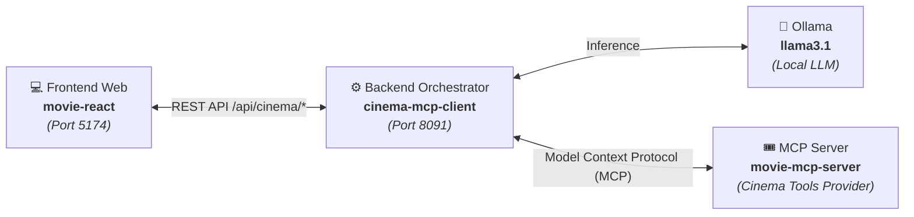

# 🎬 Cinema AX — Movie React Frontend

> **Modern, reactive, and conversational user interface for the Cinema Assistant powered by Spring AI and the Model Context Protocol (MCP).**

[](https://react.dev/)
[](https://www.typescriptlang.org/)
[](https://vitejs.dev/)
[](https://tailwindcss.com/)
[](https://zustand.docs.pmnd.rs/)

---

## 📖 Project Overview & Ecosystem Context

**Cinema AX (`movie-react`)** is the frontend client designed to provide a fluid, conversational interface for cinema inquiries, movie schedules, ratings, and personalized recommendations powered by generative AI and real-time database tools.

### 🌐 The Complete Ecosystem Architecture

This project is part of a 3-tier distributed architecture:



1. **[movie-react](https://github.com/jhonduarte7/movie-react)** *(this repository)*: Conversational single-page application built with React 19, TypeScript, Tailwind CSS v4, and Zustand.
2. **[cinema-mcp-client](https://github.com/jhonduarte7/cinema-mcp-client)**: Backend orchestrator built with Spring Boot 3.x and Spring AI that connects to Ollama (`llama3.1`) and delegates cinema tool execution via MCP.
3. **[movie-mcp-server](https://github.com/jhonduarte7/movie-mcp-server)**: Independent Model Context Protocol (MCP) server providing access to cinema catalogs, theater halls, active showtimes, genres, and audience ratings.

---

## ✨ Key Features

- 🤖 **Conversational Cinema Assistant**: Ask questions in natural language regarding current screenings, release years, synopses, and directors.
- 🎯 **Preference Filters & Biasing**: Easily filter or bias recommendations by genre (*Sci-Fi, Action, Animation, Drama, Comedy, Horror*) or target audience (*Family/All Audiences, PG-13, Adults*).
- ⚡ **One-Click Quick Inquiries**: Fast-action cards for instant queries: today's showtimes, top-rated films, sci-fi recommendations, and family-friendly movies.
- 📊 **Rich Markdown & Structured Tables**: Renders formatted assistant responses including markdown tables (movie titles, auditoriums, time slots, formats like IMAX and Dolby Atmos).
- 🌙 **Dark / Light / System Theme**: Fully responsive theme switcher with smooth transitions, OS preference detection, and `localStorage` persistence.
- 🔌 **Live MCP Connection Indicator**: Dynamic status badge that constantly monitors backend health (`http://localhost:8091`) and active LLM model (`llama3.1`).
- 🛡️ **Graceful Standby & Simulation Fallback**: If the Spring Boot backend is temporarily offline, the UI provides realistic preview responses and a helpful notice without crashing.

---

## 🛠️ Technology Stack

| Layer | Technology | Details |
| :--- | :--- | :--- |
| **UI Framework** | [React 19](https://react.dev/) | Functional components with strict TypeScript types |
| **Language** | [TypeScript 5.7+](https://www.typescriptlang.org/) | Strict type checking without `any` |
| **Bundler & Dev Server** | [Vite 6](https://vitejs.dev/) | Ultra-fast HMR and automated `/api` reverse proxy |
| **Styling** | [Tailwind CSS v4](https://tailwindcss.com/) | High-performance CSS engine (`@tailwindcss/vite`) |
| **State Management** | [Zustand 5](https://zustand.docs.pmnd.rs/) | Minimalist store for chat history and theme preferences |
| **HTTP Client** | [Axios](https://axios-http.com/) | Configured with timeout resilience and error mapping |
| **Markdown Rendering** | `react-markdown` + `remark-gfm` | Formats lists, bold tags, and markdown tables |
| **Icons** | [Lucide React](https://lucide.dev/) | Clean, accessible SVG iconography |

---

## 🚀 Getting Started

### 1. Prerequisites

- **Node.js**: `v18.0.0` or higher.
- **npm**: `v9.0.0` or higher (bundled with Node.js).
- *(Optional)*: **`cinema-mcp-client`** Spring Boot backend running on port `8091` for live AI responses.

### 2. Clone Repository

```bash
git clone https://github.com/jhonduarte7/movie-react.git
cd movie-react
```

### 3. Install Dependencies

```bash
npm install
```

### 4. Configure Environment Variables

Copy the example environment file or configure `.env`:

```bash
cp .env.example .env
```

Default configuration in `.env`:

```env
# Spring Boot Cinema MCP Client URL (default port 8091)
VITE_API_TARGET=http://localhost:8091
VITE_APP_TITLE=Cinema AX - Cinema MCP Client
```

### 5. Start Development Server

```bash
npm run dev
```

Open your browser at:
👉 **`http://localhost:5174/`**

> **Port Notice**: Defaults to port `5174` to prevent collisions if standard port `5173` is occupied.

### 6. Build for Production

```bash
# Type check and build optimized bundle
npm run build

# Preview production build locally
npm run preview
```

---

## 📡 Backend API Integration

The frontend connects to the following endpoints exposed by `cinema-mcp-client`:

| Endpoint | Method | Description |
| :--- | :--- | :--- |
| `/api/cinema/ask` | `POST` | Sends natural language prompt with optional `userPreference`. |
| `/api/cinema/recommend` | `GET` | Retrieves movie recommendations filtered by `genre` query parameter. |
| `/api/cinema/status` | `GET` | Health check endpoint validating connection to backend and MCP tools. |

### Development Reverse Proxy
In development mode, Vite automatically proxies all requests from `/api/*` to the address defined in `VITE_API_TARGET` (`http://localhost:8091`), eliminating CORS restrictions.

---

## 📁 Project Structure

```
movie-react/
├── .agents/                    # Agent workflows and guidelines
├── src/
│   ├── components/
│   │   ├── chat/
│   │   │   ├── ChatFeed.tsx    # Message container and auto-scroller
│   │   │   ├── ChatInput.tsx   # Textarea, genre preset chips, and keyboard shortcuts
│   │   │   ├── ChatMessage.tsx # Message cards with Markdown tables and copy button
│   │   │   └── QuickPrompts.tsx# Quick inquiry suggestion cards
│   │   └── common/
│   │       ├── Header.tsx      # Top navigation with title, status pill, and theme toggle
│   │       ├── StatusBadge.tsx # Real-time online/offline indicator badge
│   │       └── ThemeToggle.tsx # Light, Dark, and System appearance switcher
│   ├── lib/
│   │   └── utils.ts            # Class merging utility (clsx + tailwind-merge)
│   ├── services/
│   │   └── cinemaApi.ts        # Typed Axios client interacting with Spring AI
│   ├── stores/
│   │   ├── chatStore.ts        # Zustand store managing chat messages and standby fallback
│   │   └── themeStore.ts       # Zustand store managing theme state & HTML root synchronization
│   ├── types/
│   │   └── cinema.ts           # DTOs, ChatMessage, QuickSuggestion, and ThemeMode types
│   ├── App.tsx                 # Root layout container
│   ├── index.css               # Global stylesheet and Tailwind directives
│   └── main.tsx                # React DOM entry point
├── .env                        # Local environment variables
├── .env.example                # Example environment template
├── .gitignore                  # Git ignore rules
├── AGENTS.md                   # AI agent architecture guidelines and engineering rules
├── README.md                   # User and developer documentation
└── vite.config.ts              # Vite plugins, path aliases (@ -> src), and API proxy
```

---

## 💡 Keyboard Shortcuts & Usage Tips

- **`Enter`**: Submit prompt to assistant.
- **`Shift + Enter`**: Add a newline inside the prompt textarea.
- **Preferences Button**: Toggle predefined genre chips (*Sci-Fi*, *Action*, *Animation*, etc.) to bias AI recommendations.
- **Copy Response**: Click the clipboard icon on any assistant message to copy formatted Markdown text.

---

## 👤 Author & Related Projects

Developed by **[Jhon Duarte](https://github.com/jhonduarte7)** as part of the Cinema MCP ecosystem:
- [cinema-mcp-client](https://github.com/jhonduarte7/cinema-mcp-client)
- [movie-mcp-server](https://github.com/jhonduarte7/movie-mcp-server)
